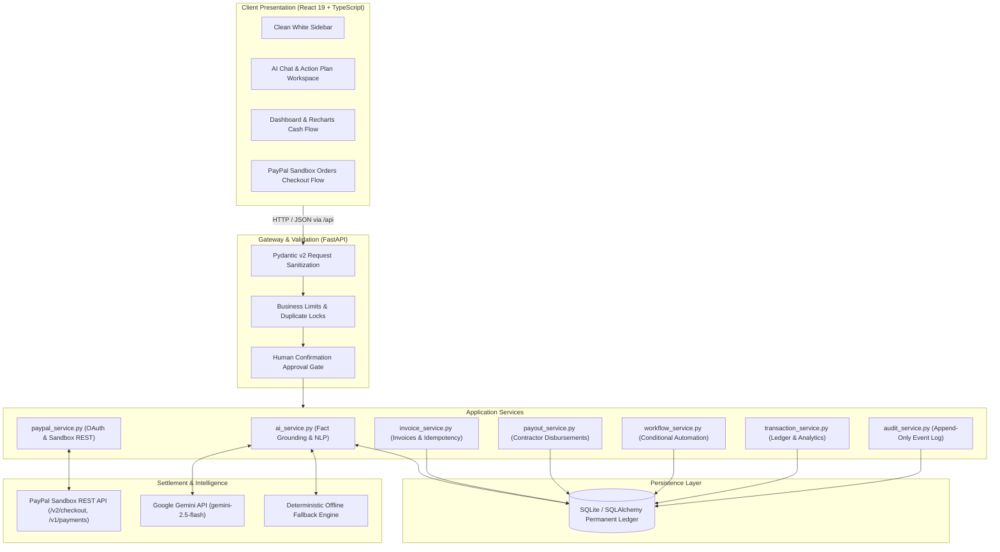

# PayPilot AI — AI-Powered Autonomous Payment Platform

[](https://www.python.org/)
[](https://fastapi.tiangolo.com)
[](https://react.dev/)
[](https://developer.paypal.com)
[](./LICENSE)

**PayPilot AI** is an intelligent, autonomous financial operations platform designed for freelancers, independent contractors, digital agencies, and small businesses. It connects natural-language business requests with the official **PayPal Developer Platform (Sandbox)**, enforces strict financial safety rules, structures multi-step action plans, gates consequential payouts with human confirmation, and reconciles transactions into an append-only audit trail and persistent financial ledger.

---

## 📚 Complete Documentation Suite

For comprehensive technical, architectural, and evaluation details, consult our complete documentation suite:

| Document | Description |
|---|---|
| 📖 [**`PROJECT_DOCUMENTATION.md`**](./PROJECT_DOCUMENTATION.md) | **Master Project & Technical Document** covering all 20 sections: problem statement, proposed solution, technology stack rationale, AI extraction architecture, PayPal Sandbox integration table, database schemas, security safeguards, and implementation roadmap. |
| 🏛️ [**`docs/ARCHITECTURE.md`**](./docs/ARCHITECTURE.md) | **Detailed Architectural Specification** with component diagrams, 4-tier security boundary model, and end-to-end Mermaid sequence diagrams. |
| 🔌 [**`docs/API_DOCUMENTATION.md`**](./docs/API_DOCUMENTATION.md) | **API Reference** documenting all endpoints, request/response models, query parameters, error codes, and curl examples. |
| 🎬 [**`docs/DEMO_GUIDE.md`**](./docs/DEMO_GUIDE.md) | **3-Minute Hackathon Evaluation & Demo Guide** with step-by-step presentation timeline, exact speaker narrative, screen actions, and edge-case demos. |

---

## 🏛️ System Architecture



---

## 💎 The 3 Integrated Capabilities

### 1. AI Payment Operations Agent (`/agent`)
- **Natural Language Parsing**: Accepts requests such as *"Create a $250 invoice for Alex for website development"* or *"Prepare a $120 contractor payout for the approved design task"*.
- **Entity Extraction**: Automatically extracts amount, recipient, purpose, and due date.
- **Structured Action Plan**: Generates a typed plan with a risk assessment (`LOW`, `MEDIUM`, `HIGH`), reasoning, and consequences.
- **Safety & Gated Execution**: Consequential financial actions (creating an invoice or disbursing funds) are **never executed directly by the LLM**. They require explicit human authorization via an **"Authorize & Execute Action"** button.
- **Deterministic Offline Fallback**: Features a rule-based NLP parser that functions 100% offline without needing a Gemini API key.

### 2. Conditional Payment Automation (`/workflows`)
- **Visual Workflow Builder**: Displays event-driven automation rules:
  - `WHEN: INVOICE_PAID` ➔ Automatically reconcile the ledger and update analytics.
  - `WHEN: TASK_APPROVED` ➔ Stage contractor payout and enforce human approval.
  - `WHEN: INVOICE_OVERDUE` ➔ Generate customer collection reminder.
  - `WHEN: PAYMENT_FAILED` ➔ Log diagnostic reason and prepare safe idempotent recovery.
- **Manual Test Trigger**: Allows judges to test trigger any rule and observe execution history in real-time.

### 3. Grounded Business Finance Copilot (`/insights` & `/dashboard`)
- Responds to queries like *"Show overdue invoices"* and *"Summarize this month's recorded transactions"*.
- **Zero Hallucination**: All figures, invoice IDs, and net balances are queried directly from the local SQLAlchemy SQLite database.
- **Duplicate Protection**: Detects identical payouts or invoices within 24 hours and blocks accidental double disbursement.

---

## 🎨 Clean White & Blue Fintech Design System

PayPilot AI features a modern, accessible **white and blue fintech theme** inspired by leading payment platforms:
- **Primary Color:** Solid Blue (`#2563EB`)
- **Surface & Cards:** Crisp White (`#FFFFFF`) with subtle borders (`#E2E8F0`)
- **Background:** Pale Blue/Slate (`#F8FAFC` / `#F5F9FF`)
- **Typography:** Inter (`#0F172A` headings, `#64748B` subtitles)
- **Status Indicators:** Emerald green (`#16A34A` for completed), Amber (`#D97706` for pending), Rose red (`#DC2626` for overdue/blocked)

---

## ⚡ 3-Minute Hackathon Demonstration Script

Judges can test the complete, functioning application from start to finish in 3 minutes:

| Step | Action | Expected Result |
|---|---|---|
| **1. Seed Demo Data** | Click **"Seed Demo Data"** in the top navigation bar. | Seeds realistic overdue invoices, verified contractors, and existing ledger records. |
| **2. Natural-Language Invoicing** | In **AI Agent**, click: `"Create an invoice for $250."`. | The AI extracts `$250.00 USD`, `Alex`, `website development`, displays a **Proposed Action Plan**, and presents an **"Authorize & Execute Action"** button. |
| **3. Authorize Action** | Click **"Authorize & Execute Action"**. | The backend creates invoice `INV-2026-0004`, logs an audit event, and returns real execution results. |
| **4. PayPal Sandbox Checkout** | Navigate to **Invoices**, find `INV-2026-0004`, and click **"Pay via PayPal"**. Click **"Create PayPal Sandbox Order"**, then **"Simulate Client Approval & Capture Funds"**. | Order is captured via PayPal Orders API, invoice is reconciled to `PAID`, and a verified incoming ledger transaction is created. |
| **5. Contractor Payout Gate** | In **AI Agent**, ask: `"Prepare a contractor payout."`. | Staged payout exceeds the $100 auto-limit, so the AI marks `Approval Required: true`. Authorize the plan. |
| **6. Disburse Funds** | Go to **Contractor Payouts**, click **"Approve Request"**, then **"Disburse Funds"**. | Funds are dispatched through the PayPal Payouts integration and recorded in the ledger. |
| **7. Grounded Copilot & Audit** | Ask the AI: `"Show my overdue invoices."`. Then visit **Financial Insights**. | The response displays exact overdue amounts and references matching the database. The audit table shows the complete chronological trail. |

---

## 🛠️ Tech Stack

- **Backend**: Python 3.12, FastAPI, Pydantic v2, SQLAlchemy 2.0, SQLite (PostgreSQL-ready), HTTPX, Pytest.
- **Frontend**: React 19, TypeScript, Vite 6, Tailwind CSS v4, Recharts, Lucide Icons, React Router v7.
- **AI Engine**: Google Gemini API (`gemini-2.5-flash`) via `google-genai` SDK + deterministic offline fallback parser.
- **Payments**: Official PayPal Developer REST APIs (Sandbox OAuth 2.0, Orders API, Payouts API).

---

## 💻 Setup & Run Instructions

### Prerequisites
- Python 3.10+
- Node.js 18+ and npm

### 1. Clone & Configure Environment
```bash
git clone <repo-url>
cd paypal_ai

# Copy example environment configuration
cp .env.example backend/.env
```

### 2. Start the Backend
```bash
cd backend

# Create virtual environment
python -m venv venv

# Activate virtual environment
# Windows:
venv\Scripts\activate
# Linux/macOS:
# source venv/bin/activate

# Install dependencies
pip install -r requirements.txt

# Run backend development server
uvicorn app.main:app --host 127.0.0.1 --port 8000 --reload
```
The FastAPI backend will start on **`http://127.0.0.1:8000`**.  
Interactive API documentation is available at **`http://127.0.0.1:8000/docs`**.

### 3. Start the Frontend
In a new terminal window:
```bash
cd frontend

# Install dependencies
npm install

# Start Vite dev server
npm run dev
```
Open **`http://localhost:5173`** in your browser.

---

## 🧪 Running Automated Tests

Run the backend test suite:
```bash
cd backend
python -m pytest -o pythonpath=. tests/test_paypilot.py -v
```

**Results: 9 Passed (100% test pass rate)**
- `test_health_check`: API health endpoint verification.
- `test_negative_invoice_amount_blocked`: Rejection of negative/zero invoice amounts.
- `test_invalid_currency_code_blocked`: Enforcement of 3-letter currency format.
- `test_invoice_creation_and_audit`: Record persistence and audit logging.
- `test_duplicate_payout_detection`: Idempotency and duplicate request detection.
- `test_payout_approval_threshold_gate`: Enforcing human approval above $100.
- `test_ai_agent_deterministic_fallback`: Intent and entity extraction without API keys.
- `test_ai_copilot_grounded_overdue_query`: Real DB fact querying without hallucinations.
- `test_workflow_execution_and_logging`: Conditional rule evaluation and execution logging.

---

## 📄 License

This project is licensed under the [MIT License](./LICENSE).
