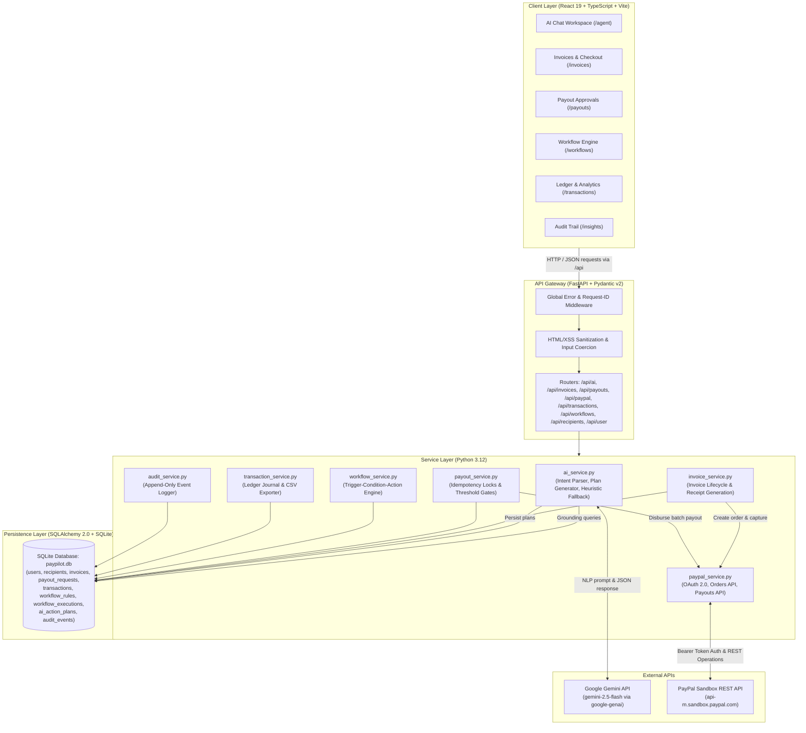
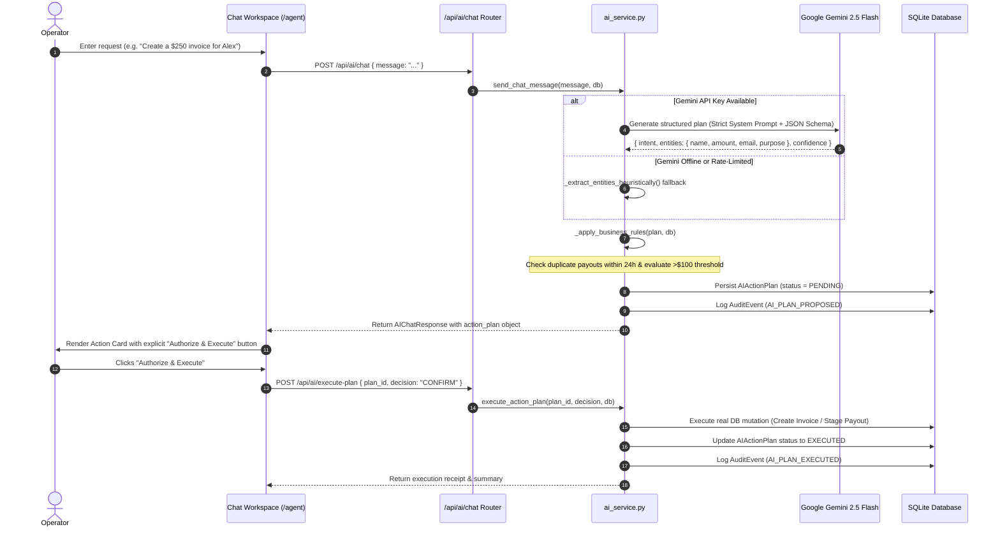
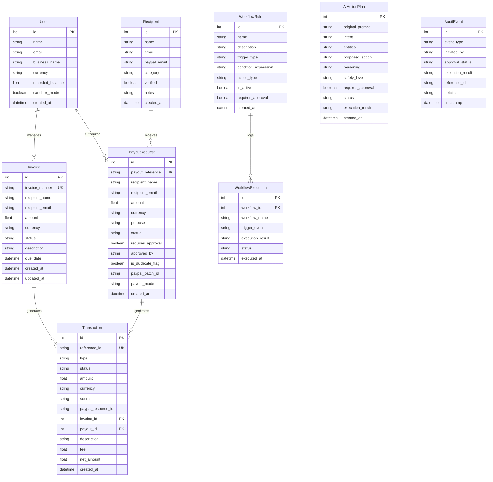

# PayPilot AI - Autonomous Payment Operations Platform

[](https://www.python.org/)
[](https://fastapi.tiangolo.com)
[](https://react.dev/)
[](https://www.typescriptlang.org/)
[](https://developer.paypal.com)
[](./backend/tests)
[](./LICENSE)

PayPilot AI is an autonomous financial operations copilot built for small businesses, agencies, and operators. It transforms natural language instructions into structured, policy-validated payment workflows executed over official PayPal Sandbox REST APIs. Every action is recorded in an audit log and synchronized with a double-entry ledger.

<div align="center">

### Watch Demo Video

[](https://youtu.be/qQSeYp4fPis)

[](https://youtu.be/qQSeYp4fPis)

[https://youtu.be/qQSeYp4fPis](https://youtu.be/qQSeYp4fPis)

</div>

---

## 1. Problem Statement

Small businesses and digital agencies spend hours each week coordinating payment operations across fragmented interfaces:
- Manually drafting client invoices, tracking payment links, and chasing overdue accounts.
- Switching between banking dashboards and payout lists to disburse contractor compensation.
- Bearing the financial and administrative costs of accidental duplicate payouts submitted by multiple operators.
- Performing end-of-month reconciliation where bank statements, invoice statuses, and accounting ledgers diverge.
- Addressing the AI safety dilemma: pure autonomous execution of financial actions by LLMs is unsafe without deterministic validation, policy thresholds, and human-in-the-loop authorization.

---

## 2. Proposed Solution

PayPilot AI bridges natural-language instruction and financial settlement through a 4-tier model:
1. **Conversational Intent to Structured Action:** Users interact via natural language. The system extracts entities and returns a typed `AIActionPlan` detailing proposed operations, rationale, risk tier, and parameters.
2. **Deterministic Business Policy Layer:** Before reaching payment gateways, requests pass through hardcoded validation rules and 24-hour idempotency checks.
3. **Human-in-the-Loop Safeguards:** Consequential financial operations (disbursements exceeding $100 or high-risk mutations) cannot be executed by the model alone; they require operator confirmation.
4. **Direct PayPal Sandbox Rails:** Approved workflows execute against official PayPal REST APIs (Orders API for receivables, Payouts API for disbursements) and settle into a persistent local ledger.

---

## 3. System Architecture

The following diagram illustrates the component architecture, control flow, and data boundaries implemented across the codebase:



---

## 4. How the AI Agent Works

The AI agent architecture separates language understanding from database mutation:



### Heuristic Fallback Engine
If the external Gemini API is unreachable, unconfigured, or rate-limited, `ai_service.py` falls back to an offline rule-based parser. Regular expressions and domain dictionaries extract amounts, ISO currencies, client names, and recipient emails. This guarantees zero downtime for core commands during testing or evaluation.

---

## 5. Gemini and PayPal Integration Flow

The integration separates conversational reasoning from monetary execution:
- **Gemini is not given direct API keys to PayPal.** The LLM cannot autonomously initiate network requests to PayPal endpoints.
- **Structured Contracts:** Gemini outputs an explicit operational plan (`CREATE_INVOICE`, `STAGE_PAYOUT`, `QUERY_OVERDUE`, `RECONCILE_LEDGER`).
- **Backend Validation:** The FastAPI backend inspects the generated plan, validates parameters against Pydantic schemas, and executes the designated service (`invoice_service.py` or `payout_service.py`).
- **PayPal Execution:** The dedicated PayPal service (`paypal_service.py`) handles OAuth 2.0 token acquisition and sends structured requests to `api-m.sandbox.paypal.com`.

---

## 6. Payment Processing: Invoices and Payouts

### Invoicing Flow (Receivables / Money-In)
1. **Creation:** Invoices are created via the AI Chat or the `/invoices` modal with invoice number, client details, amount, currency, and line items.
2. **Status Tracking:** Invoices are marked `SENT` with an assigned due date.
3. **PayPal Checkout:** Clicking "Pay via PayPal" initializes a checkout session via `/api/paypal/create-order`, creating an order record in the PayPal Sandbox Orders API.
4. **Capture & Settlement:** Upon customer payment, `/api/paypal/capture-order` captures funds.
5. **Reconciliation:** The invoice status updates to `PAID`, a transaction record of type `INCOMING_PAYMENT` is written to the ledger, and an audit entry is recorded.

### Contractor Payout Flow (Disbursements / Money-Out)
1. **Staging:** Payouts are staged via natural language or the `/payouts` interface with contractor name, PayPal email, amount, and purpose.
2. **Duplicate Check:** `payout_service.py` evaluates active payouts for identical recipient email and amount values submitted within the last 24 hours. Matches are flagged with `is_duplicate_flag = True`.
3. **Approval Gate:** Payouts exceeding $100 are assigned `PENDING_APPROVAL` status. They cannot be disbursed until a human operator clicks "Approve".
4. **Disbursement:** Once approved, clicking "Disburse Funds" invokes `/api/payouts/{id}/execute`. The service sends a single batch payout request via the PayPal Payouts API (`/v1/payments/payouts`) with an idempotency key (`TX-PAYOUT-{id}-{timestamp}`).
5. **Ledger Record:** The payout status updates to `COMPLETED`, logging a `CONTRACTOR_PAYOUT` record in the ledger.

---

## 7. Human-in-the-Loop and Financial Safeguards

| Safeguard | Implementation Mechanism | Code Reference |
| :--- | :--- | :--- |
| **$100 Approval Threshold** | Payout requests exceeding $100 require human authorization (`requires_approval = True`). Payouts remain in `PENDING_APPROVAL` until approved via `/api/payouts/{id}/approve`. | `backend/app/services/payout_service.py` |
| **Idempotency & Duplicate Locking** | Evaluates recipient email, currency, and amount across a 24-hour window. Flags duplicates to prevent multiple disbursements for the same task. | `backend/app/services/payout_service.py` |
| **Input Sanitization (XSS & Injection)** | String fields in Pydantic schemas pass through `html.escape` field validators. Invalid currencies, negative values, and malformed emails trigger 422 errors. | `backend/app/schemas.py` |
| **Append-Only Audit Logging** | Every AI proposal, execution, approval, rejection, and webhook receipt is logged with timestamp, actor, reference ID, and outcome. | `backend/app/services/audit_service.py` |
| **Zero-Hallucination Copilot** | Financial summaries and overdue invoice lists query active SQLite records directly rather than relying on generative model memory. | `backend/app/services/ai_service.py` |

---

## 8. Database Architecture and Backend Services

The application uses SQLAlchemy 2.0 with a SQLite persistence engine (`backend/paypilot.db`). Path resolution is anchored to the backend module directory to ensure stable database access regardless of execution working directory.

### Relational Schema



---

## 9. Technology Stack

- **Backend:** Python 3.12, FastAPI, Pydantic v2, SQLAlchemy 2.0, SQLite, Uvicorn, HTTPX, Pytest.
- **Frontend:** React 19, TypeScript 5.7, Vite 6, Tailwind CSS, Recharts, Lucide Icons, React Router v7.
- **Payment Gateway:** PayPal Sandbox REST APIs (OAuth 2.0, Orders v2, Payouts v1, Webhook receiver).
- **AI Runtime:** Google Gemini 2.5 Flash / Gemini Pro via `google-genai` SDK + deterministic heuristic fallback.

---

## 10. Installation and Setup

### Prerequisites
- Python 3.10 or higher
- Node.js 18 or higher with npm

### 1. Clone the Repository
```bash
git clone https://github.com/your-username/paypal_ai.git
cd paypal_ai
```

### 2. Configure Environment Variables
```bash
cp .env.example backend/.env
```
*(Optional: set your `PAYPAL_CLIENT_ID`, `PAYPAL_CLIENT_SECRET`, and `GEMINI_API_KEY` in `backend/.env`. If omitted, the application runs with simulated sandbox responses and the heuristic fallback parser).*

### 3. Backend Setup
```bash
cd backend
python -m venv venv

# Windows:
.\venv\Scripts\activate
# Linux/macOS:
# source venv/bin/activate

pip install -r requirements.txt
uvicorn app.main:app --host 127.0.0.1 --port 8000 --reload
```
The FastAPI backend will start on **`http://127.0.0.1:8000`**.  
Interactive Swagger documentation is available at **`http://127.0.0.1:8000/docs`**.

### 4. Frontend Setup
In a separate terminal window:
```bash
cd frontend
npm install
npm run dev
```
Open **`http://localhost:5173`** in your browser.

---

## 11. Automated Verification Suite

The backend includes 13 automated unit and integration tests covering data validation, idempotency, audit logging, and route operations:

```bash
cd backend
python -m pytest -o pythonpath=. tests/test_paypilot.py -v
```

### Test Suite Coverage
1. `test_health_check`: Verifies API gateway status endpoint.
2. `test_negative_invoice_amount_blocked`: Asserts zero and negative invoice amounts trigger 422 validation errors.
3. `test_invalid_currency_code_blocked`: Asserts non-ISO currency codes are rejected.
4. `test_invoice_creation_and_audit`: Verifies invoice persistence and corresponding audit trail entry.
5. `test_invoice_receipt_and_deletion`: Tests receipt generation and deletion cascade.
6. `test_duplicate_payout_detection`: Validates 24-hour idempotency duplicate flagging.
7. `test_payout_approval_threshold_gate`: Verifies payouts exceeding $100 enter approval-required states.
8. `test_ai_agent_deterministic_fallback`: Verifies entity extraction without external API keys.
9. `test_ai_copilot_grounded_overdue_query`: Validates database grounding for overdue account queries.
10. `test_workflow_execution_and_logging`: Validates conditional rule triggering and execution history.
11. `test_user_profile_crud`: Tests user profile retrieval and update endpoints.
12. `test_transactions_export_csv`: Validates CSV export generation and header formatting.
13. `test_paypal_webhook_handler`: Tests incoming webhook event processing and status reconciliation.

---

## 12. Verification and Demo Guide

Follow this 3-minute sequence to evaluate core platform workflows:

1. **Seed Evaluation Data:** Click **"Seed Demo Data"** in the top navigation bar. This populates overdue invoices, verified contractors, and ledger history.
2. **Test Natural Language Invoicing:** Navigate to **AI Agent** (`/agent`) and submit:  
   `Create a $250 invoice for Alex for website development`  
   Review the structured action plan card and click **"Authorize & Execute Action"**.
3. **Execute PayPal Checkout:** Navigate to **Invoices** (`/invoices`), select the created invoice, and click **"Pay via PayPal"**. Complete the sandbox payment capture to observe automatic ledger reconciliation.
4. **Test Payout Safety Gate:** In the **AI Agent**, submit:  
   `Prepare a $120 contractor payout for approved tasks`  
   Because the amount exceeds $100, the action is marked for approval. Navigate to **Contractor Payouts** (`/payouts`), review the staged item, click **"Approve"**, and then click **"Disburse Funds"**.
5. **Inspect Ledger and Export:** Open **Transactions** (`/transactions`) to review the reconciled double-entry journal. Click **"Export CSV"** to verify spreadsheet output.

---

## 13. Project Status: Implemented vs Future Scope

### Implemented Functionality
- Full natural-language parsing with Google Gemini 2.5 Flash and heuristic fallback parser.
- Structured AI action planning with risk classification and operator approval gating.
- Human-in-the-loop controls enforcing approval on payouts exceeding $100.
- 24-hour idempotency and duplicate payout detection.
- Complete invoice lifecycle management with printable receipt viewing.
- Official PayPal Sandbox integration: OAuth 2.0 authentication, Orders API (v2), Payouts API (v1), and Webhook receiver.
- Conditional workflow automation engine with pause/resume toggling and manual test execution.
- Double-entry transaction ledger with multi-column sorting, debounced filtering, and CSV export.
- System-wide append-only audit trail logging all actions, actors, and references.
- Complete test suite with 13 automated unit and integration tests.

### Future Scope (Planned)
- Multi-currency conversion service using live FX rates during settlement.
- Recurring subscription and billing schedules via the PayPal Subscriptions API.
- Native mobile companion application (React Native) for push notifications and on-the-go approvals.
- Bi-directional accounting integration for external ledger synchronization (QuickBooks, Xero).

---

## 14. License

This project is licensed under the [MIT License](./LICENSE).
