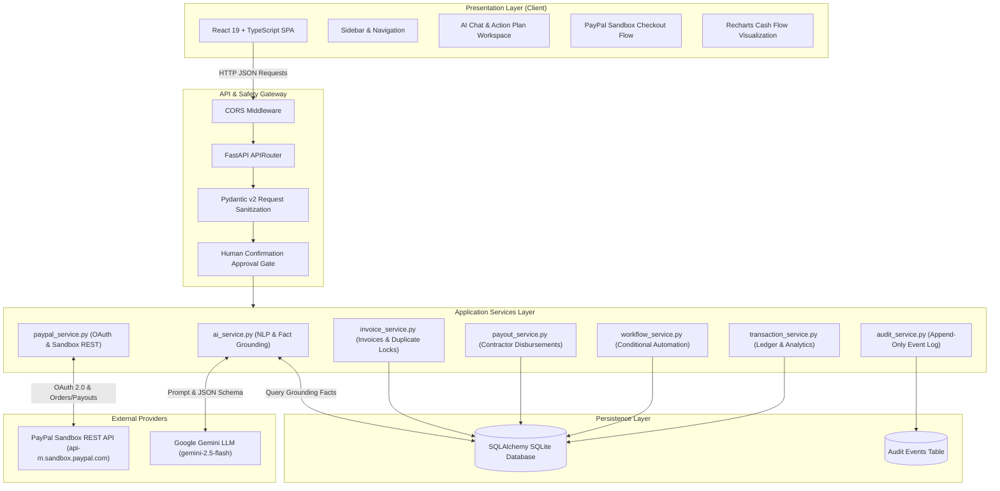
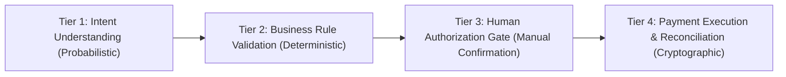
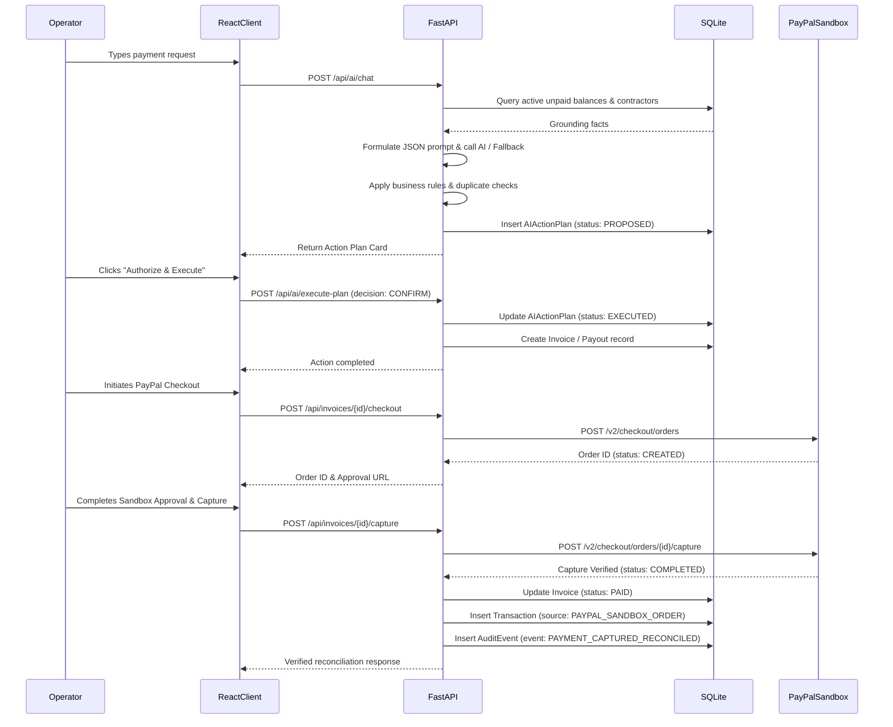

# PayPilot AI — Architectural Specification

## 1. High-Level Architecture Overview

PayPilot AI is built as a modular, decoupled full-stack architecture dividing responsibilities cleanly across:
1. **Frontend Presentation & Interaction Layer** (React 19, TypeScript, Tailwind CSS, Recharts)
2. **Backend API & Orchestration Layer** (FastAPI, Pydantic v2, HTTPX)
3. **AI Reasoning & Extraction Layer** (Google Gemini API with Deterministic Offline Fallback)
4. **PayPal Developer Sandbox Settlement Layer** (OAuth 2.0, Orders API, Payouts API)
5. **Relational Data & Audit Persistence Layer** (SQLAlchemy ORM, SQLite / PostgreSQL)

---

## 2. Security Boundaries & The Financial Safety Model

The primary vulnerability of LLM-based financial applications is **uncontrolled execution authority**. If a model can directly invoke database queries or payment APIs, prompt injection attacks or hallucinations can cause disastrous financial loss.

PayPilot AI implements a strict, 4-tier security boundary:

1. **Tier 1 — Probabilistic Extraction:** The LLM parses the natural-language prompt. The output is strictly treated as untrusted draft input.
2. **Tier 2 — Deterministic Server-Side Validation:** The backend validates:
   - Amounts are positive (`amount > 0`).
   - Currency is valid ISO 4217 code.
   - Payout amounts above `$100.00` strictly mandate human approval (`requires_approval = True`).
   - Duplicate protection checks if identical recipient and amount occurred in the past 24 hours.
3. **Tier 3 — Human Confirmation Gate:** The plan is persisted with `status = "PROPOSED"`. Execution is physically impossible until an authenticated operator submits an explicit confirmation (`POST /api/ai/execute-plan` with `decision = "CONFIRM"`).
4. **Tier 4 — Cryptographic Settlement:** The backend generates an idempotent PayPal Request ID, executes the authorized REST API call, verifies the returned capture status, and only then writes to the permanent ledger.

---

## 3. Component Interaction Sequence

